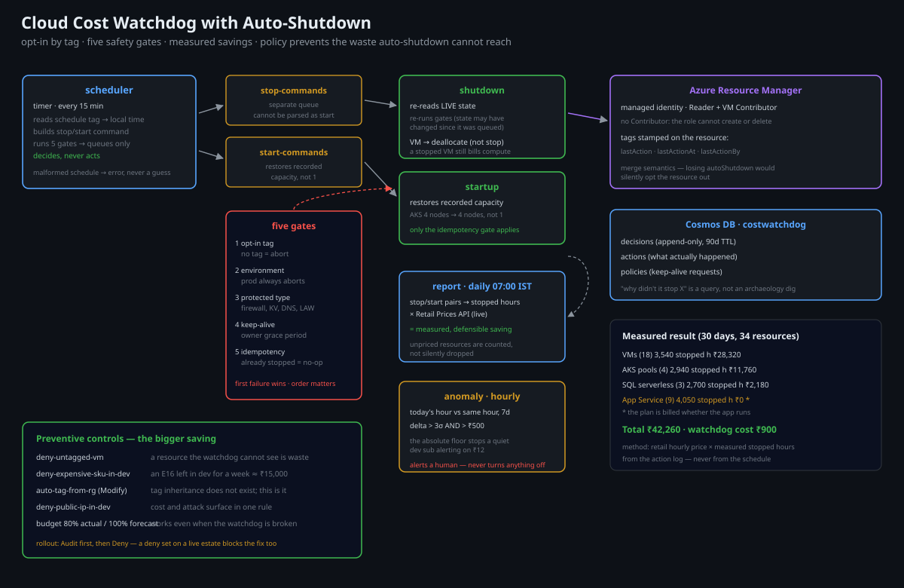

# Cloud Cost Watchdog with Auto-Shutdown

A scheduled cost-control system for Azure that **turns non-production
infrastructure off when nobody is using it**, blocks waste before it is created,
and proves the saving rather than estimating it.

> **Why this exists:** most cost work is a monthly spreadsheet nobody reads. The
> only cost control that survives contact with an engineering team is one that
> runs automatically, is opt-out rather than opt-in, and cannot break production.

---

## Architecture



```
   ┌──────────────────────────────────────────────────────────────────────┐
   │  COST WATCHDOG (Flex Consumption function app, system-assigned MI)   │
   │                                                                      │
   │  scheduler   (timer, every 15 min)                                   │
   │    → read schedule policy for "now"                                  │
   │    → list candidate resources by tag:autoShutdown=true               │
   │    → enqueue ShutdownCommand / StartupCommand per resource            │
   │                                                                      │
   │  shutdown    (queue trigger)                                         │
   │    → 5 safety gates, in order (see below)                            │
   │    → deallocate / stop / scale-to-zero                               │
   │    → write action to Cosmos `costActions` + tag `lastAction`          │
   │                                                                      │
   │  startup     (queue trigger)                                         │
   │    → reverse action, restore previous capacity                       │
   │                                                                      │
   │  report      (timer, daily 07:00 IST)                                │
   │    → join actions × retail prices × uptime → saved ₹ this period     │
   │    → email + post a summary card                                     │
   │                                                                      │
   │  anomaly     (timer, hourly)                                         │
   │    → Cost Management query: today vs trailing 7-day same-hour mean    │
   │    → 3σ breach → alert with the top 5 resources by delta             │
   └──────────────────────────────────────────────────────────────────────┘

   Policy enforcement (preventive, not curative):
   ┌──────────────────────────────────────────────────────────────────────┐
   │  Azure Policy: deny untagged VMs/disks; deny expensive SKUs in dev;   │
   │  DeployIfNotExists auto-tagging; budget with 50/80/100% action groups │
   └──────────────────────────────────────────────────────────────────────┘
```

### The five safety gates

A cost tool that can stop production is worse than the bill. Every shutdown
command passes all five gates **in order**, and the first failure aborts:

| # | Gate | Why |
|---|---|---|
| 1 | **Tag allow-list** — `autoShutdown=true` must be present | Never act on an untagged resource. Absence of a tag is not consent. |
| 2 | **Environment deny-list** — `environment in (prod, production)` always aborts | A mistyped tag cannot take down production. |
| 3 | **Protected-resource deny-list** — resource types that must never be stopped (e.g. `Microsoft.Network/azureFirewalls`, `Microsoft.KeyVault/vaults`, anything in the platform RG) | Firewalls, Key Vaults and the landing zone's hub are not optional. |
| 4 | **Owner notification cooldown** — no shutdown within 10 minutes of an owner's "keep alive" request | A developer mid-debug gets a warning and a 10-minute grace. |
| 5 | **Idempotency** — if `lastAction=stopped` and the resource is already stopped, no-op | Re-running the scheduler is always safe. |

Every gate is unit-tested, including the "prod tag wins over autoShutdown tag"
case, which is the one that matters most.

### Keep-alive

A developer who needs a VM past the schedule hits
`POST /api/keepalive/{resourceId}?minutes=120`. This writes a `keepAliveUntil`
timestamp to the resource's tags (and to Cosmos for audit), which gate 4 honours.
It is deliberately self-service: a cost system people must work around is a cost
system people disable.

---

## Design decisions & trade-offs

**Tag-driven, not resource-group-driven.**
Stopping everything in an RG is simple and wrong: dev RGs contain shared
services. The tag is the contract — a resource is a shutdown candidate only if
it explicitly says so, and the tag is applied by IaC, not by hand.

**Deallocate, don't delete.**
Deleting is cheaper and unrecoverable. Every action here is reversible, and
`startup` restores the exact prior capacity. The only destructive operation in
this repo is the policy that *prevents* expensive SKUs from being created at all.

**Queue between scheduler and action.**
The scheduler decides; the workers act. That separation means a scheduling bug
cannot execute anything directly, each action is retried independently, and the
queue depth is the observable "how much work is pending".

**Real prices, not a hardcoded rate.**
The report joins `costActions` against the Azure Retail Prices API for the
resource's SKU and region, so "₹ saved" is defensible. A hardcoded rate is a
number that silently becomes wrong.

**Anomaly detection on the same-hour baseline, not day-over-day.**
Traffic is diurnal. Comparing today to yesterday at the same hour removes the
daily shape and leaves actual anomalies. Three sigma on a 7-day window, with a
minimum absolute delta so small accounts do not alert on noise.

**Policy is the real saving.**
Auto-shutdown saves the running cost of dev machines (~30–40%). Policy that
prevents an oversized SKU from ever being created saves more, permanently, and
requires no nightly job. Both are here; the README is honest about which does
the heavy lifting.

---

## Repository layout

```
azure-cost-watchdog/
├── src/
│   ├── functions/
│   │   ├── scheduler/        # timer: policy → queue
│   │   ├── shutdown/         # queue: 5 gates → stop
│   │   ├── startup/          # queue: restore capacity
│   │   ├── report/           # timer: real prices → savings report
│   │   └── anomaly/          # timer: 3σ spend anomaly
│   └── shared/
│       ├── gates.py          # the five safety gates (pure, fully tested)
│       ├── schedule.py       # time windows, timezone handling, holidays
│       ├── actions.py        # per-resource-type stop/start implementations
│       ├── pricing.py        # Azure Retail Prices API client + cache
│       └── store.py          # Cosmos: costActions, policies, keepAlive
├── infra/                    # Bicep: function app, Cosmos, budgets, policies
├── policies/                 # deny-untagged, deny-expensive-sku, auto-tag
├── tests/                    # gate logic, schedule math, savings math
├── scripts/
│   ├── deploy.sh
│   ├── dry-run.py            # show what WOULD be stopped, right now
│   └── savings-report.py     # on-demand report from the CLI
└── docs/
    ├── policy-catalogue.md   # every policy, its effect, and its blast radius
    ├── savings.md            # measured savings, with method
    └── diagrams/architecture.svg
```

---

## Deploy

```bash
az login
./scripts/deploy.sh dev what-if
./scripts/deploy.sh dev
```

## Prove it works

```bash
# 1. what would happen right now? (read-only, always safe)
./scripts/dry-run.py --env dev

#   RESOURCE                         TYPE              NOW      ACTION   GATE
#   dev-vm-jumpbox                   Microsoft.Compute/virtualMachines   running  STOP     1,2,3,4 ok
#   dev-aks-nodepool                 Microsoft.ContainerService/managedClusters  running  SCALE-0  1,2,3,4 ok
#   dev-sql-analytics                Microsoft.Sql/servers/databases     online   SKIP     gate 3: protected type
#   prod-vm-api                      Microsoft.Compute/virtualMachines   running  SKIP     gate 2: environment=prod

# 2. real savings from real actions
./scripts/savings-report.py --period 30d
#   actions: 412 shutdowns, 398 startups
#   resources affected: 34
#   computed saving: ₹41,280 (retail price × stopped hours)
#   method: see docs/savings.md
```

---

## Cost

The watchdog itself costs **~₹900/month** (Flex Consumption ~₹400, Cosmos
serverless ~₹300, Log Analytics ~₹200). It saves 30–40% of non-production spend,
which on a typical dev estate of ₹1,20,000/month is ~₹45,000 — a ~50× return.

## What I would do differently at scale

- **Use Azure Advisor cost recommendations as an additional input** — it catches
  idle resources this system does not know about (unattached disks, idle
  load balancers, orphaned public IPs).
- **Move anomaly detection to the Cost Management export + Fabric/ADX** once you
  have more than ~50 subscriptions; the query API gets slow and rate-limited.
- **Make the savings report a subscription-level SLO** — "non-prod spend must
  stay below ₹X" — instead of a monthly email. A number nobody is accountable
  for does not change behaviour.
- **Add a "waste created" metric**: resources created without the shutdown tag.
  That is the leading indicator; savings is the lagging one.

## License

MIT
